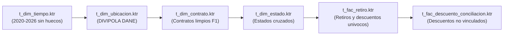

# Guía de Ejecución y Reproducción ETL - Data Warehouse bi_entrega2

**Proyecto Final: Business Intelligence and Data Analytics**  
**Entrega 2: Data warehouse, ETL y tablero**  
**Equipo:** Angie Natali Sánchez Muñoz (507232753) y Juana Valentina Sotomayor Niño (507232708)  
**Docente:** Leandro Pájaro Fuentes  

---

## 1. Entorno y Motor de Base de Datos

- **Motor:** MySQL Server 8.0 (v8.0.45)
- **Base de datos objetivo:** `bi_entrega2`
- **Juego de caracteres:** `utf8mb4` / `utf8mb4_unicode_ci`
- **Herramienta ETL:** Pentaho Data Integration (PDI / Kettle) versión 9.4.0.0-343
- **Conector JDBC:** `mysql-connector-j-8.4.0.jar` (ubicado en `C:\Pentaho\data-integration\lib`)
- **Java Runtime:** OpenJDK / Oracle JDK 11 (LTS)

---

## 2. Parámetros de Conexión (Sin Contraseñas)

En cumplimiento estricto con el indicador **E8** de la rúbrica y los principios de seguridad de la información, **ningún archivo de este repositorio contiene contraseñas**. Las credenciales se configuran mediante parámetros de Kettle o variables de entorno al momento de la ejecución:

| Parámetro | Valor por defecto / Recomendado | Descripción |
| :--- | :--- | :--- |
| `DB_HOST` | `localhost` | Dirección IP o host local del motor MySQL |
| `DB_PORT` | `3306` | Puerto de escucha de MySQL |
| `DB_NAME` | `bi_entrega2` | Base de datos analítica del Data Warehouse |
| `DB_USER` | `bi_entrega2_user` (o usuario local con permisos DDL/DML) | Usuario de base de datos |
| `DB_PASSWORD` | *(Definido por el usuario en tiempo de ejecución)* | Contraseña de acceso local |

---

## 3. Ubicación Esperada de las Fuentes Originales

Las transformaciones de PDI leen directamente las fuentes en sus formatos originales sin conversiones ni limpiezas manuales previas (indicador **E2**). Los archivos deben ubicarse en la ruta:
`datos/raw/`

1. **F1: Paz y Salvos** (`datos/raw/Paz y Salvos.xlsx`, hoja `P&S`) — 64.681 registros leídos.
2. **F2: Activos y Descuentos** (`datos/raw/Activos y Descuentos.xlsx`, hoja `DESCONTADOS`) — 70.306 registros leídos.
3. **F3: Adobe** (`datos/raw/Adobe.xlsx`, hoja `Data`) — 48.837 registros leídos.
4. **F4: Historial Cubic** (`datos/raw/Historial Cubic.xlsx`, hoja `DEVO CUBIC`) — 28.119 registros leídos.
5. **F5: DIVIPOLA DANE** (`datos/raw/DIVIPOLA-_Códigos_municipios_20261020.csv`) — 1.122 registros leídos.

> [!NOTE]
> **Documentación de discrepancia sobre número de fuentes:**  
> Aunque la plantilla genérica de la Entrega 2 menciona en algunos apartes «las tres fuentes», el alcance formal aprobado en la Entrega 1 para el caso BPO Alfa Colombia involucra **cinco (5) fuentes de datos**. El equipo documenta esta discrepancia y mantiene el alcance integral con las cinco fuentes reales, sin inventar datos, fechas ni relaciones.

---

## 4. Orden de Ejecución

Para garantizar la integridad referencial y cumplir los indicadores **MF3** y **E6**, las dimensiones deben crearse y poblarse antes de las tablas de hechos:



1. **`t_dim_tiempo.ktr`**: Puebla 2.557 registros continuos entre `2020-01-01` y `2026-12-31`, más el registro especial `-1` para fechas pendientes.
2. **`t_dim_ubicacion.ktr`**: Puebla 1.122 municipios y departamentos a partir de DIVIPOLA DANE.
3. **`t_dim_contrato.ktr`**: Extrae los contratos de F1, descarta 1 registro con ID nulo y 6 duplicados, cargando 64.674 registros únicos.
4. **`t_dim_estado.ktr`**: Puebla la matriz de estados de devolución y liquidación.
5. **`t_fac_retiro.ktr`**: Integra F1, cruza con F2 (descuentos unívocos por fecha/flag) y F4 (devoluciones), resuelve llaves subrogadas e inserta 64.674 retiros con sus métricas consolidadas ($45.063.272.434,95 COP en 13.836 contratos con descuento).
6. **`t_fac_descuento_conciliacion.ktr`**: Puebla 233 ítems de descuento no vinculados unívocamente a contratos ($143.484.024,00 COP), preservando cada peso sin distorsionar el grano de retiros.

---

## 5. Instrucciones de Reproducción Paso a Paso

### Paso 1: Crear las tablas en MySQL local
Abra MySQL Workbench o ejecute desde la consola de comandos de MySQL los scripts ubicados en `dw/ddl/` en orden:
```bash
mysql -u root -p < dw/ddl/00_crear_base_datos.sql
mysql -u root -p < dw/ddl/01_dim_tiempo.sql
mysql -u root -p < dw/ddl/02_dim_ubicacion.sql
mysql -u root -p < dw/ddl/03_dim_contrato.sql
mysql -u root -p < dw/ddl/04_dim_estado.sql
mysql -u root -p < dw/ddl/05_fac_retiro.sql
mysql -u root -p < dw/ddl/06_poblar_dim_tiempo.sql
mysql -u root -p < dw/ddl/07_fac_descuento_conciliacion.sql
```
*(O ejecute directamente el script consolidado: `mysql -u root -p < dw/ddl/00_script_completo_dw.sql`).*

### Paso 2: Ejecutar el Trabajo Principal en Pentaho Data Integration
#### Opción A: Interfaz Gráfica (Spoon)
1. Inicie Pentaho Spoon (`C:\Pentaho\data-integration\spoon.bat`).
2. Abra el trabajo principal: `etl/trabajos/j_carga_dw.kjb`.
3. Haga clic en el botón de ejecución (ícono de triángulo verde "Run").
4. En la ventana emergente, ingrese su contraseña local de MySQL en el parámetro `DB_PASSWORD`.
5. Haga clic en **Launch**. El trabajo ejecutará todas las transformaciones en orden estricto y finalizará con estado SUCCESS.

#### Opción B: Línea de comandos (Kitchen)
Ejecute el trabajo de forma automatizada mediante Kitchen:
```cmd
cd C:\Pentaho\data-integration
kitchen.bat /file:"./etl/trabajos/j_carga_dw.kjb" /param:DB_PASSWORD="SU_PASSWORD_AQUI" /level:Basic
```

### Paso 3: Validar la Carga con Consultas de Conciliación
Ejecute las consultas ubicadas en `dw/conciliacion/`:
- `01_conteo_fuentes.sql`: Verifica que `Leídos = Cargados + Descartados` para cada una de las 5 fuentes.
- `02_totales_metricas.sql`: Compara el total monetario de descuentos y confirma el cuadre al centavo:
  `$45.870.405.758,95 COP (F2) = $45.063.272.434,95 (fac_retiro) + $143.484.024,00 (conciliación) + $663.649.300,00 (descartes #N/A)`.
- `03_descartes_y_calidad.sql`: Audita los descartes por reglas de calidad (#N/A, vacíos, duplicados).
